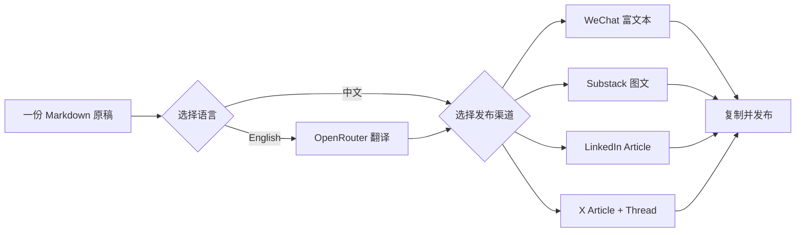

# 一份 Markdown，发布到四个平台：我做了一个多渠道发布工具箱

[lead] 写内容时，我只想专心表达；但真正准备发布时，常常还要重新调标题、改颜色、处理代码、截图公式，再为不同平台各做一遍。于是我做了「Markdown 发布工具箱」：写一份 Markdown，生成适合 WeChat、Substack、LinkedIn 和 X 的可复制发布格式。


> 这篇文章既是产品介绍，也是一个可以直接复制到工具里的完整 Demo。继续读，你会依次看到标题、强调、列表、表格、代码、公式和 Mermaid 图表的实际效果。

## 写完文章，为什么还没法直接发布？

Markdown 很适合写作：结构清楚、格式简单，也不绑定某个编辑器。但到了发布环节，问题就来了：

- 微信公众号需要带内联样式的富文本，普通 Markdown 不能直接使用；
- Substack 和 LinkedIn 的排版习惯不同，表格、公式和图表也不一定能原样粘贴；
- X 不仅需要 Article，还需要适合传播的 Thread，以及需要单独上传的图片素材；
- 同一篇文章要发布中文和英文版本时，复制、翻译和校对又会形成一套重复流程。

如果只是偶尔发布，这些步骤似乎还能接受。但当写作变成长期习惯，**排版就不该继续占用创作时间**。

## 它是什么，又不是什么？

Markdown 发布工具箱的定位很简单：它是一个 **format-first 的多渠道格式转换器**。

你提供一份 Markdown 原稿，选择目标平台和输出语言，工具负责生成适合该平台的预览与内容；确认效果后，复制到对应平台发布即可。

它目前不替你定时发布，也不会接管平台账号。这样做的好处是：发布前的最后一次检查仍然掌握在创作者手里，使用流程也足够轻量。

## 一份原稿，四种发布结果

| 发布渠道 | 工具生成的内容 | 适合的使用方式 |
|---|---|---|
| WeChat | 带模板、主题色、代码高亮、公式和图表的公众号富文本 | 复制样式后粘贴到公众号编辑器 |
| Substack | 接近平台阅读体验的文章预览与可移植富文本 | 复制图文后继续在 Substack 编辑 |
| LinkedIn | 独立的 LinkedIn Article 排版与可移植富文本 | 复制图文后发布长文 |
| X | Article 正文、主 Thread、要点 Thread 和编号图片素材 | 先复制文字，再按编号上传素材 |

这张表本身也是 Demo：切换到 Substack 或 LinkedIn 后复制时，工具会把 Markdown 表格转成更容易跨平台携带的图片；切换到 X 时，它会被整理成编号素材。

## 从写作到发布，只需要这条流水线



你不需要维护四份内容。渠道切换发生在同一个编辑器里，修改原稿后，预览也会跟着更新。

## 不只是把 Markdown 变成 HTML

### 常用格式开箱即用

普通正文里可以直接使用这些通用格式，不需要记住新的私有语法：

*这是斜体，用来补充语气。*

**这是粗体，用来强调重点。**

***这是粗斜体，同时拥有两种强调。***

这里还有一段 `行内代码`。

---

任务清单也沿用通用写法：

- [x] 完成 Markdown 原稿
- [x] 选择目标发布渠道
- [ ] 粘贴到平台并做最后检查

### 1. 让公众号排版保留自己的风格

WeChat 渠道提供 **默认模板、极简风格、杂志风** 3 套模板，并内置 7 个主题色，也可以直接输入品牌色。标题、引用、链接、代码块和强调内容会跟随主题变化。

[lead] 像这一段开头的 `[lead]` 标记，会在 WeChat 渠道中变成醒目的引导段。它适合放摘要、核心观点或章节导语。

### 2. 图片不再打断写作

你可以使用远程图片、仓库中的相对路径图片，也可以把截图或本地图片直接粘贴、拖入编辑器。对于 Obsidian 用户，工具还能识别这样的附件引用：

```markdown
![[Pasted image 20260818133657.png]]
```

只要再选择同名本地图片，短引用就可以继续保留，预览和复制时再使用真正的图片内容。

### 3. 代码、公式和图表可以一起走

下面这段代码会以语法高亮形式显示：

```javascript
const result = await ChannelConverter.renderForChannel(
  "wechat",
  markdown,
  {
    outputLanguage: "zh",
    templateId: "wechat-magazine",
    themeColor: "#7E3AF2"
  }
);

console.log(result.previewHtml);
```

简单的行内关系式直接使用通用数学符号，在各个平台更稳定。比如，可以把一次多渠道发布的重复劳动粗略写成：C = n × (E + F)，其中 n 是平台数量，E 是编辑成本，F 是排版成本。

复杂公式仍然可以使用独立公式块。使用一份原稿和统一转换流程后，可以把它简化为：

$$
C_{toolkit} = E + \sum_{i=1}^{n} A_i
$$

其中 Aᵢ 只代表每个平台最后的检查和微调。公式不是为了精确计时，而是为了说明一件事：**应该被消除的是重复排版，而不是创作者的判断。**

### 4. 中英文输出使用同一套流程

所有渠道都可以选择 `中文` 或 `English`。中文模式直接使用原稿；需要英文时，可以在设置中配置 OpenRouter。工具会尽量保留 Markdown 结构、代码、公式、链接和图片引用，并在不同渠道之间复用同一篇原稿的译文。

> 浏览器直连 API Key 更适合个人使用。如果要把工具提供给团队，建议改用后端代理，避免在前端暴露密钥。

## 30 秒体验一次完整发布

1. 打开 [Markdown 发布工具箱](https://lizabethli.github.io/markdown-to-wechat-converter/)；
2. 复制这篇文章的 Markdown 原文，粘贴到左侧编辑器；
3. 选择 `WeChat`，切换模板和主题色，观察右侧预览；
4. 再切换到 `Substack` 或 `LinkedIn`，比较不同平台的文章样式；
5. 选择 `X Article + Thread`，查看正文、Thread 和编号素材；
6. 点击复制按钮，把结果粘贴到目标平台做最后检查。

如果你想快速检查功能，也可以直接使用这份清单：

- [x] 标题与正文层级
- [x] 粗体、链接和引用
- [x] 有序列表与任务清单
- [x] Markdown 表格
- [x] 代码语法高亮
- [x] 行内与块级数学公式
- [x] Mermaid 流程图
- [x] 远程图片
- [x] 多渠道与中英文输出

## 为什么我选择“复制即用”

自动发布听起来更彻底，但也意味着账号授权、平台 API、草稿管理和失败重试。对于个人创作者和小团队，很多时候真正费时间的并不是点击“发布”，而是发布前的格式整理。

所以这个项目先解决最稳定、最普遍的一段流程：

> 保留 Markdown 的写作自由，同时把不同平台的格式差异交给工具处理。

它不要求你改变写作软件，也不要求把内容迁移到新的内容系统。你仍然可以在 Obsidian、VS Code、Typora 或任何喜欢的编辑器里完成原稿。

## 开源，也欢迎一起继续完善

项目不需要安装依赖，下载后直接打开 `index.html` 就能使用：

```bash
git clone https://github.com/LizabethLi/markdown-to-wechat-converter.git
cd markdown-to-wechat-converter
open index.html
```

目前的核心流程已经覆盖 WeChat、Substack、LinkedIn 和 X。未来还可以继续扩展 Medium、Notion、Slack 等 formatter，让“写一次，适配多个内容平台”变得更完整。

- 在线体验：[Markdown 发布工具箱](https://lizabethli.github.io/markdown-to-wechat-converter/)
- 项目源码：[GitHub Repository](https://github.com/LizabethLi/markdown-to-wechat-converter)

**如果你也在用 Markdown 写作，不妨直接把这篇文章复制进去试试。你看到的每一种格式，都是这个工具正在完成的工作。**
